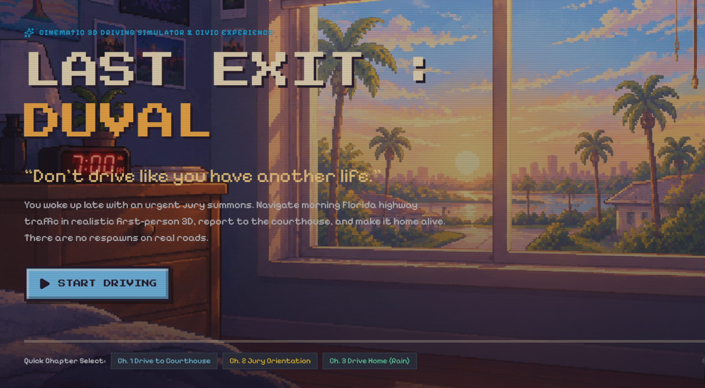
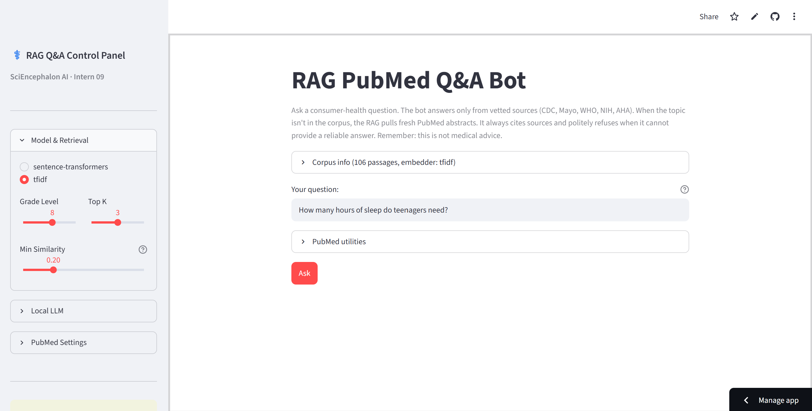
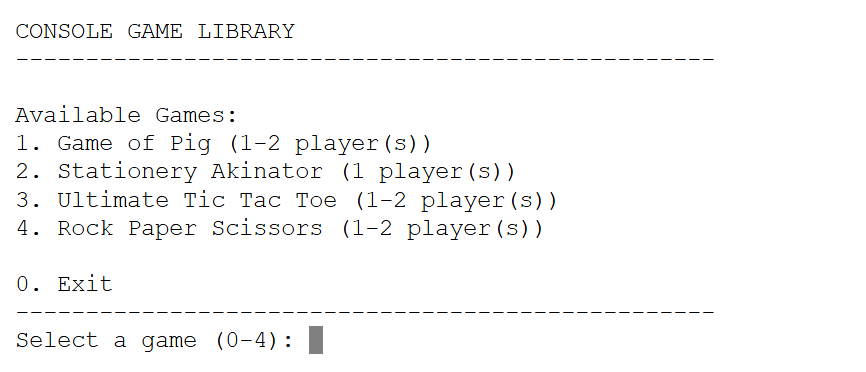

<h1> Hi, I'm Shirley! </h1>

**I turn random ideas into real projects and love experimenting with new technologies.**
 

 
<h2> Things I've built with ♡ </h2>
 
<table>
  <tr>
    <td align="center" width="33%" valign="top">
      
      <h3>Last Exit: Duval</h3>
      
A cinematic 3D driving simulator that teaches defensive driving through an immersive, interactive experience.

      
<code>React</code> · <code>Three.js</code> · <code>Vite</code>

      <a href="https://last-exit-duval.vercel.app/">▶ Play</a> &nbsp;·&nbsp;
      <a href="https://github.com/ShirleyYaw/LastExit-Duval-3DDriverSim">GitHub</a>
    </td>
    <td align="center" width="33%" valign="top">
      
      <h3>PubMed Chatbot</h3>
      
A Streamlit RAG chatbot that retrieves PubMed literature to ground AI responses in scientific research. Explores TF-IDF and MiniLM retrieval.

      
<code>Python</code> · <code>Streamlit</code> · <code>RAG</code> · <code>NLP</code>

      <a href="https://pubmedchatbot.streamlit.app/">▶ Try </a> &nbsp;·&nbsp;
      <a href="https://github.com/ShirleyYaw/09_rag_qa_pubmed">GitHub</a>
    </td>
    <td align="center" width="33%" valign="top">
      
      <h3>Python Console Games</h3>
      
A collection of console games from Programming Club, exploring game logic, user input, and programming fundamentals.

      
<code>Python</code> · <code>CodeHS</code>

      <a href="https://codehs.com/sandbox/shirleyyaw/console-games/run">▶ Play</a>
    </td>
  </tr>
</table>

 
<h2> What I'm into </h2>
 
- Game development
- Artificial intelligence & machine learning
- Software development
- Creative coding
- Cybersecurity/Digital Safety

 
<h2> Tech stack </h2>
<table>
  <tr>
    <td><b>Languages</b></td>
    <td>
      
      
      
      
    </td>
  </tr>
  <tr>
    <td><b>Frameworks & Libraries</b></td>
    <td>
      
      
      
      
      
    </td>
  </tr>
  <tr>
    <td><b>Machine Learning</b></td>
    <td>
    
    
    
  </tr>
  <tr>
    <td><b>Tools</b></td>
    <td>
      
      
      
      
      
    </td>
  </tr>
  <tr>
    <td><b>Deployment</b></td>
    <td>
      
      
      
      
    </td>
  </tr>
  <tr>
    <td><b>Design</b></td>
    <td>
    
    
    </td>
  </tr>
  <tr>
  <td><b>Currently learning</b></td>
  <td>
  
  
  
  </td>
  </tr>
</table>
 
 
Check out my [repositories](https://github.com/ShirleyYaw?tab=repositories) to see what I've been up to!
 

thanks for stopping by ♡
 

 
